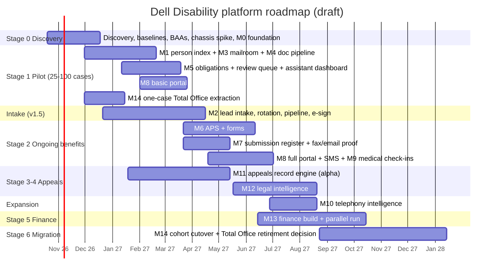

# Dell Disability case platform: modules, timeline and roadmap

12 October 2026. This is a draft for discussion, written on branch `research/dell-case-platform`. It draws on four sources:
- the firm's Master AI Blueprint v1.5 and the AI Employee Vision deck (October 2026);
- the requirements fit map and the competitive research in `Case management Platform/`;
- the open-source research in [`oss-alternatives.md`](oss-alternatives.md);
- the Alpha Brain fit score in [`fit-matrix.md`](fit-matrix.md).

All durations are rough estimates for the team named in §5, not measurements. They will move after Stage 0 discovery.

## 1. Decisions this plan rests on

1. **Multi-user lives in the platform, not in Alpha Brain.** Alpha Brain is single-user by design. Making it multi-user means rewriting its core assumptions (estimated at 5–8 months). Instead, the firm's staff work in an open-source system of record that already handles users, roles and per-record access. Alpha Brain runs as a **headless "AI employee"**: one service identity that reads, drafts, extracts and proposes, while people approve in the system of record or in Outlook and Teams.
2. **Buy the commodities, assemble open source for the middle, and build only the disability-specific core.** The fit map's rule still holds: deterministic code for deadlines, money and status; AI only for extraction, classification, comparison and drafting; a person approves every outward action.
3. **Every model call that sees client data goes through an API covered by a BAA.** That means Azure AI Foundry under the firm's Microsoft BAA, or Anthropic's API with a BAA and zero data retention. Local models are an option for high-volume extraction. **Nothing goes through the personal Claude Code subscription or web search.**
4. **The Microsoft 365 tenant is the identity provider for staff** (Entra ID, MFA). Keycloak is used only for client-portal identities.
5. **Work happens on this branch** (`research/dell-case-platform`, cut from `origin/main`). To pick up later Alpha Brain changes, run `git merge origin/main` here. Firm source documents (`.docx`) stay outside the repository because they are confidential.

## 2. Target architecture

```
                 Staff (Entra ID SSO + MFA)                    Clients (Keycloak)
                          │                                          │
     ┌────────────────────┴──────────────────────┐     ┌─────────────┴────────────┐
     │ System of record: EspoCRM or Twenty        │     │ Client portal (thin app)  │
     │ leads · clients · matters · obligations ·  │◄───►│ assignments · Docassemble │
     │ tasks · queues · roles · per-record ACL    │ API │ questionnaires · uploads  │
     └────────────────────┬──────────────────────┘     │ submission history        │
                          │ events / API               └──────────────────────────┘
     ┌────────────────────┴───────────────────────────────────────────────────────┐
     │ Workflow + rules (deterministic): deadline calculators · obligation state   │
     │ machines · reminders/escalation · approvals   [Postgres job table → Temporal]│
     └───────┬───────────────┬────────────────┬───────────────┬───────────────────┘
             │               │                │               │
   ┌─────────┴──────┐ ┌──────┴───────┐ ┌──────┴──────┐ ┌──────┴────────────┐
   │ Mailroom       │ │ Document     │ │ Appeals     │ │ Finance            │
   │ Graph capture  │ │ pipeline     │ │ record      │ │ expected receipts  │
   │ case matching  │ │ OCRmyPDF ·   │ │ engine      │ │ BAI2 ingest · fee  │
   │ (Splink index) │ │ Docling ·    │ │ page ledger │ │ engine · statements│
   │                │ │ LangExtract  │ │ chronology  │ │ → bought trust     │
   └────────────────┘ │ provenance   │ │ Q&A · drafts│ │   ledger (CosmoLex │
                      └──────────────┘ └─────────────┘ │   / Clio Acctg)    │
                                                       └────────────────────┘
     AI worker: Alpha Brain core, headless (runtime + MCP tools + journal/provenance
     + approval state machine + journeys eval), model via BAA API gateway
     Storage: Postgres · Azure Blob with immutable (WORM) policy · encrypted at rest
     Transports (bought, BAA): M365 mail · fax API · Twilio HIPAA / Azure Comms SMS ·
     Nextiva (XSI events) · DocuSeal or DocuSign
```

**Choosing the system of record** is a 2-week spike in Stage 0, scored on four things:
- per-record (per-matter) access control;
- REST/webhook API completeness;
- custom objects and layouts;
- workflow hooks.

**Default: EspoCRM**, which has the more mature team- and role-based record access. **Fallback: Twenty**, which has the more modern UI and data model. Both are AGPL, so run them unmodified and extend them through their extension and API surfaces.

**Workflow engine:** start with a Postgres job table plus deterministic calculators. `ponytail:` adopt Temporal (MIT) once more than about three long-running multi-step workflows need retries and durable timers, probably by Stage 2.

## 3. Module catalog

Each module lists:
- the Blueprint scope;
- the open-source and bought components;
- what must be custom-built;
- where Alpha Brain is reused;
- its acceptance measure (from Blueprint §14).

Effort is in engineer-weeks (ew).

### M0 · Platform foundation (Stage 0, ~10 ew)
- **Scope:** Blueprint §2, §12.
- **Components:**
  - Azure tenant under the Microsoft BAA: Postgres, Blob with immutability policy, Key Vault;
  - Entra ID SSO and MFA for staff; Keycloak for clients;
  - system of record installed and roles defined (owner, attorney, legal assistant, intake, receptionist, finance, admin, client);
  - an audit log that records the actor on every write;
  - backups and restore drills;
  - a model gateway (Azure AI Foundry / Anthropic API under BAA, local models optional).
- **Custom build:** the per-matter access policy; the model gateway, which logs every prompt and output against the matter and redacts on request; and **prompt-injection isolation**: the extraction step has no tools, outputs are validated against a schema, and third-party text is never treated as an instruction.
- **Alpha Brain reuse:**
  - add a **model route for a business API** (needed regardless; the router already supports two routes);
  - add a **headless mode** (no desktop, service identity);
  - turn **web search and the second-opinion check off** for client data.
- **Acceptance:** penetration-test findings closed; a restore drill passes; BAAs in writing for every vendor that touches client data.

### M1 · Person index and duplicate detection (Stage 1, ~4 ew)
- **Scope:** Blueprint intake §B–C and §H; also feeds M2, M10 and M14.
- **Components:** **Splink** (MIT) running on Postgres/DuckDB over leads, clients and the Total Office extract, across both brands.
- **Custom build:**
  - two thresholds: auto-link above, human review in the middle band, **never merge**;
  - a review queue that shows the evidence for each match;
  - inquiry events and marketing attribution kept separate from the person record.
- **Alpha Brain reuse:** the hard-key entity model and the undoable merge pattern.
- **Acceptance:** duplicate-detection precision and recall on deidentified test data; zero automatic merges.

### M2 · Lead intake, assignment and pipeline (Stages 1–2, ~10 ew)
- **Scope:** Blueprint v1.5 intake module §A–I; Vision scenarios 7–10.
- **Components:**
  - **OpnForm** (or the CRM's web-to-lead) per brand, with the raw submission written to WORM storage before parsing; fallback is parsing the owner's form-notification emails through M3;
  - the CRM pipeline with the 12 stages;
  - Power Automate Approvals / Outlook actionable messages for assign / ask / hold / decline;
  - **DocuSeal** or DocuSign for fee agreements;
  - **Superset** (or Power BI) for dashboards.
- **Custom build:**
  - auditable random attorney rotation with eligibility rules, an exception queue, and duplicate checks before rotation;
  - every lead must have "a next step with a due date, or an approved hold reason";
  - attempt / contact / consultation kept as separate events;
  - the intake follow-up protocol encoded **only after intake hands it over in writing**;
  - prospect → client conversion without rekeying;
  - counting unique people, not touches.
- **Alpha Brain reuse:** consultation briefing drafts and suggested owner replies, as approval cards.
- **Acceptance:** no manual Total Office lead entry; duplicate rate measured; assignment-to-contact time reported per attorney and brand.

### M3 · Mailroom: Outlook capture and case matching (Stage 1 pilot, ~8 ew)
- **Scope:** Blueprint §3 (first half); Vision scenario 1.
- **Components:** Microsoft Graph app-only `Mail.Read`, limited by RBAC for Applications to the authorized mailboxes; change notifications plus delta queries; raw `.eml` files and attachments to WORM storage.
- **Custom build:**
  - the matching cascade: thread → claim-number regex → verified sender directory → LLM tie-break with a confidence score;
  - an ambiguity review queue;
  - **no automatic filing below threshold**.
- **Alpha Brain reuse:** this is Alpha Brain's first job as the AI employee. The core, running headless, consumes new-mail events. It needs **event triggers**, which Alpha Brain does not have yet (today automations run on a schedule only).
- **Acceptance:** correct automatic match rate and wrong-file rate measured on the pilot mailboxes (Blueprint §14) before automatic filing is switched on.

### M4 · Document pipeline: OCR, classification, extraction with provenance (Stage 1, ~8 ew)
- **Scope:** Blueprint §3, §5, §9.3 (shared with M11).
- **Components:**
  - **OCRmyPDF** and **Docling** (MIT) for page text and layout; **olmOCR** for hard pages (GPU);
  - an LLM classifier with structured output covering about 20 classes, including blank vs signed form, medical record, EOB and correspondence;
  - **LangExtract** (Apache-2.0) for extractions anchored to character spans, mapped back to page and bounding box through Docling;
  - **Label Studio** for building gold sets.
- **Custom build:**
  - a provenance store (value → document, page, bounding box, source type);
  - confidence-threshold routing to a review queue;
  - signature-presence detection (commonforms' signature field detector is a starting point).
- **Alpha Brain reuse:** the "every value has a source" journal model; the 400k-character cap goes away because the pipeline works per page.
- **Acceptance:** classification accuracy measured per class on deidentified insurer samples; 100% of extracted values either grounded in a source or flagged.

### M5 · Obligations, deadlines and reminders (Stage 1, ~6 ew)
- **Scope:** Blueprint §3; Vision scenario 1.
- **Components:** CRM tasks and queues; the workflow job table (→ Temporal later); M365 email and Teams notifications.
- **Custom build:**
  - one insurer request → a **parent request plus independently tracked obligations**, each with its insurer deadline, internal target date and owner;
  - the AI extracts each obligation with a source quote, code computes the dates, and a paralegal confirms before any task is written;
  - escalation before deadlines;
  - **a request closes only when every obligation has a documented submission**. A draft existing, or a task being marked done, never counts as submitted.
- **Alpha Brain reuse:** the action state machine (proposed → approved → done) as the pattern for confirmation.
- **Acceptance:** share of tasks created automatically; missed deadlines; minutes per request against the baseline.

### M6 · APS and insurer forms (Stage 2, ~10 ew)
- **Scope:** Blueprint §4–5; Vision scenario 2.
- **Components:**
  - **Docassemble** (MIT) for the claimant's "what changed since the last APS" questionnaire and for claimant statements;
  - **commonforms** to turn flat insurer PDFs into fillable forms, and **pypdf** to fill them (avoid PyMuPDF, which is AGPL);
  - DocuSeal or DocuSign for physician and client signatures.
- **Custom build:**
  - an insurer → form → version library;
  - **per-field provenance**: historical APS, client statement, medical record, or physician confirmation; an old physician opinion is never carried forward as newly verified;
  - a queue for fields that can't be answered;
  - legal-assistant approval;
  - the three-document physician package (prior signed APS, new firm-reviewed draft, new blank form);
  - a completeness check on the returned signed form.
- **Acceptance:** median preparation time, revisions, physician rejections, client turnaround.

### M7 · Submission register and transport (Stage 2, ~5 ew)
- **Scope:** Blueprint §3 (second half); Vision scenario 5.
- **Components:** Graph send; a **bought** HIPAA fax API (Documo / eFax Corporate); WORM storage.
- **Custom build:**
  - one record per outgoing package, holding the exact file hashes, a verified insurer address/fax directory, sender, recipient and timestamp;
  - three independent statuses: **Sent / Delivery confirmed / Insurer acknowledged**;
  - publishing approved final versions to the portal.
- **Acceptance:** every submission can be traced to its request, and every file to its hash.

### M8 · Client portal and communications (Stages 1–2, ~10 ew)
- **Scope:** Blueprint §6; Vision "five views" and the portal sections.
- **Components:**
  - a thin portal app on the system-of-record API, with Keycloak logins;
  - Docassemble interviews;
  - uploads to Blob storage (Nextcloud File drop as an alternative);
  - **Novu** (MIT) for notifications through M365 email and **Twilio HIPAA or Azure Communication Services** SMS;
  - **Chatwoot** as the two-way SMS inbox (check its audit-log tier).
- **Custom build:**
  - a needs-list assignment model (the Floify pattern): one consolidated assignment per request, with per-item status;
  - a unified communication log;
  - internal vs client-visible separation by default;
  - SMS that only links to the portal and never carries PHI.
- **Stage 1 scope:** a basic portal for 25–100 pilot cases.
- **Acceptance:** client completion rates; no internal or draft item ever visible to a client (tested).

### M9 · Proactive medical monitoring (Stage 2, ~4 ew)
- **Scope:** Blueprint §7; Vision scenario 3.
- **Components:** the job table; Docassemble check-in; M8 notifications.
- **Custom build:**
  - a 90–120-day cohort job and post-appointment prompts;
  - a provider / last-visit / record-status tracker;
  - AI identifies the physician, visit and document type on uploaded records.
- **Deferred:** patient-directed FHIR (**Medplum**, Apache-2.0; Fasten OnPrem is archived) and paid record retrieval, which needs ethics review.
- **Alpha Brain reuse:** the scheduler pattern.
- **Acceptance:** check-in completion, time from visit to record receipt.

### M10 · Telephony intelligence (Expansion, ~6 ew)
- **Scope:** Blueprint §8; Vision scenario 4.
- **Components:**
  - **keep Nextiva**; BroadWorks **XSI-Events** feed the screen-pop against the M1 person index, with a receptionist search page as the fallback;
  - recordings (once Nextiva confirms an export or SIPREC path) and PLAUD exports go to **WhisperX / faster-whisper** on a GPU host (or whisper.cpp on Apple Silicon);
  - a summary from the BAA-covered model.
- **Custom build:**
  - a consent flag per call;
  - proposed tasks go to an approval queue;
  - transcripts restricted to authorized staff and never published to the portal.
- **Gate:** counsel's consent and notice policy must exist before any recording.
- **Acceptance:** transcript-to-case link accuracy, staff correction rate, consent compliance.

### M11 · Appeals record engine (Stage 3 alpha, ~14 ew)
- **Scope:** Blueprint §9.1–9.3; tested on 500, 2,500 and 10,000+ page records.
- **Components:**
  - SHA-256 hash, page count and a Bates regex;
  - OCRmyPDF/Docling per page with a quality score;
  - **RAGFlow** (Apache-2.0) or **PaperQA2** for record-grounded Q&A;
  - **OpenContracts** (MIT) for human review of rows with their source spans;
  - **medspaCy** for negation and sections;
  - **Presidio** for optional de-identification;
  - **promptfoo** gold sets.
- **Custom build:**
  - a **100% page ledger** (indexed pages vs total pages);
  - document segmentation that protects overlapping pages;
  - medical and claim chronologies with **page citations taken from metadata, never from model output**;
  - claimant report vs physician finding vs insurer inference kept distinct;
  - contradictions preserved;
  - a coverage report;
  - record versioning by page hash, with dependent rows marked stale.
- **Alpha Brain reuse:** the strongest fit. Single-attorney use, provenance and the journey eval suite all carry over; the work is page-level indexing on SQLite full-text search.
- **Acceptance:** 100% page accounting, page-citation accuracy, material omission rate on gold-standard chronologies supplied by appeals leadership.

### M12 · Legal intelligence (Stage 4, ~12 ew)
- **Scope:** Blueprint §9.2, §9.4–9.5.
- **Components:**
  - LangExtract with a checklist schema for an **ERISA checklist engine** (§2560.503-1, Glenn, Nord), maintained by attorneys;
  - **CourtListener** API for public case law only;
  - Docassemble for **physician functional-capacity questionnaires**, where physician fields always stay blank;
  - a citation-check script, plus OnlyOffice/Collabora for redlines.
- **Custom build:**
  - an insurer-review assertion matrix (each IME or peer-review claim vs the treating evidence: cited / ignored / contradicted);
  - denial reason → required proof → evidence plan;
  - an appeal drafting workspace with versions and attorney sign-off gates;
  - **no external transmission until explicitly approved**.
- **Acceptance:** attorney hours, evidence-plan completeness, correction burden.

### M13 · Finance and trust (Stage 5 parallel run, ~14 ew)
- **Scope:** Blueprint §10; Vision scenario 6.
- **Components:**
  - **buy** the trust ledger (CosmoLex, Clio Accounting or TrustBooks) as the book of record;
  - BAI2 over SFTP or the CashPro API (eligibility through the BofA relationship manager);
  - **Blnk** or SQL for reconciliation matching;
  - **moov-io/ach** only if the firm builds NACHA files itself.
- **Custom build** (the AppFolio pattern):
  - an expected-receipt schedule per client and benefit period;
  - variance alerts for missing, changed and zero-dollar EOBs and offsets;
  - a versioned fee-agreement rules engine with golden tests that recomputes on reversals;
  - draft statements for attorney and finance approval;
  - disbursements with maker ≠ checker, dual release above a threshold, and a cool-off when bank details change;
  - commissions on the operating ledger only.
- **Gate:** the CFO's ACH lifecycle document. Run in parallel with the current process until reconciliations agree for 3 consecutive months.
- **Acceptance:** zero unexplained trust differences.

### M14 · Total Office migration (Stages 1 → 6, ~10 ew spread out)
- **Scope:** Blueprint §11.
- **Components:**
  - **buy** Universal Migrator's Total Office extraction;
  - **dlt / pgloader** into Postgres;
  - **Great Expectations** for integrity checks (record counts, attachments, hashes, author and date preserved).
- **Custom build:** mapping to the new schema; parallel-run reconciliation; cohort cutover; a read-only legacy archive.
- **Stage 1 milestone:** read-only extraction of one complete case (Blueprint §16).
- **Acceptance:** zero orphaned correspondence per cohort; Total Office retired only after functional, operational and financial acceptance.

### M15 · Analytics and acceptance metrics (continuous, ~3 ew)
- **Components:** **Superset** (Apache-2.0) or the existing Power BI, reading the person, touch, obligation and submission tables.
- **Scope:** the baseline metrics agreed in Stage 0, then every §14 measure above.

**Total: about 134 engineer-weeks** across 15 modules plus the foundation.

## 4. Roadmap

Start date assumed: Monday 19 October 2026. Phases overlap on purpose: the appeals track is independent of ongoing benefits, so it runs in parallel with its own engineer.



| Stage | Window | Release gate (from Blueprint §13) |
|---|---|---|
| 0 Discovery | 19 Oct – 18 Dec 2026 | Process maps for 5 live requests; baseline metrics; BAAs signed; system of record chosen; one Total Office case extracted read-only; security architecture reviewed |
| 1 Pilot | 30 Nov 2026 – 26 Mar 2027 | Email matching and attachment classification measured on real mailboxes **before** any automatic filing; review queue in daily use; basic portal for 25–100 cases |
| Intake | 21 Dec 2026 – 16 Apr 2027 | No manual lead entry; duplicate precision proven; attorney rotation audited; e-sign → activation without rekeying |
| 2 Ongoing benefits | 22 Mar – 2 Jul 2027 | Three-document APS packages released only after approval; submission register with three statuses; medical check-ins running |
| 3 Appeals alpha | 18 Jan – 14 May 2027 | 100% page accounting and citation accuracy on 500, 2,500 and 10,000+ page records against gold chronologies |
| 4 Legal intelligence | 17 May – 20 Aug 2027 | Attorney sign-off gates; evidence plans and physician questionnaires reviewed by appeals leadership |
| Expansion: telephony | 28 Jun – 20 Aug 2027 | Consent policy approved by counsel; Nextiva event/recording access confirmed |
| 5 Finance | 14 Jun – 15 Oct 2027 | Three months of parallel reconciliation with zero unexplained differences, before any integration that moves funds |
| 6 Migration | 23 Aug 2027 – 14 Jan 2028 | Cohort-by-cohort cutover; zero orphaned items; retirement decision |

**End to end: about 15 months** to the Total Office retirement decision. The ongoing-benefits pilot is usable from about **month 5** (March 2027), and appeals chronologies from about **month 7** (May 2027).

## 5. Team and cost assumptions

- **Team:** 2 full-stack engineers (system of record, portal, workflow), 1 AI/data engineer (M3, M4, M11, M12), a half-time DevOps/security engineer, a half-time PM/QA, plus named firm subject-matter experts (Blueprint §16: ongoing benefits, appeals, finance, IT, client experience). That is about 3.5 engineering FTE × ~60 weeks ≈ 210 ew of capacity against ~134 ew estimated. The slack covers discovery findings, integration surprises and change management.
- **Bought (recurring):**
  - Azure (hosting, Blob, AI Foundry usage) under the Microsoft BAA;
  - fax API;
  - SMS carrier (HIPAA tier);
  - DocuSign (if DocuSeal's API is paywalled);
  - a trust-accounting product;
  - Universal Migrator (one-off, ~$3.5k+);
  - GPU time for transcription and olmOCR, or one GPU host.
- **Open source:** no license fees. The firm carries patching, hosting and compliance itself.

## 6. Risks and open questions

| Risk | Mitigation / owner |
|---|---|
| Total Office access: schema, export rights and the vendor contract are unconfirmed (Blueprint §11) | Stage 0 one-case extraction; buy Universal Migrator. **IT** |
| Nextiva won't expose call events or recordings | Fall back to PLAUD or softphone recordings, transcribed in batches; drop the screen-pop to a receptionist search page. **IT** |
| AGPL obligations if the system of record is modified | Extend only through extension and API surfaces; counsel reviews the license register in `oss-alternatives.md`. **Legal** |
| OCR accuracy on faxed and handwritten insurer forms | Confidence routing to human review; olmOCR for hard pages; measure per class before automating. **AI engineer** |
| Wrong-file email matches | Two thresholds, review queue, no automatic filing until the measured wrong-file rate is accepted. **Operations** |
| Trust-accounting compliance | Bought ledger; three months of parallel run; dual control. **CFO** |
| HIPAA applicability and BAA scope | Counsel decides applicability; BAAs in writing per vendor and tier. **Legal** |
| Alpha Brain stays single-user | By design: it runs headless as a service identity, and permissions and approvals live in the system of record (§1). |
| Intake follow-up protocol and CFO ACH lifecycle not yet documented | Nothing is configured from assumptions; these are gating inputs. **Intake lead / CFO** |

## 7. First 30 days (merges Blueprint §16 with this plan)

1. Name the executive sponsor and module owners; confirm the team in §5.
2. Map five live ongoing-claim requests end to end; agree the baseline metrics.
3. Collect ten deidentified insurer emails/forms and three deidentified administrative records (about 500, 2,500 and 10,000+ pages).
4. Sign or confirm BAAs: Microsoft (Azure AI Foundry in scope), fax API, SMS carrier.
5. Run the system-of-record spike (EspoCRM vs Twenty) against the four criteria in §2.
6. Validate a read-only extraction of one complete Total Office case.
7. Prototype Graph capture plus case matching on one pilot mailbox, and measure errors before any automation.
8. Prototype the page ledger plus chronology on one large administrative record, with an attorney-led source audit.
9. Ask Nextiva in writing about XSI-Events access and the recording export or SIPREC path.
10. Add the business API model route and headless mode to Alpha Brain on this branch's follow-up work.
